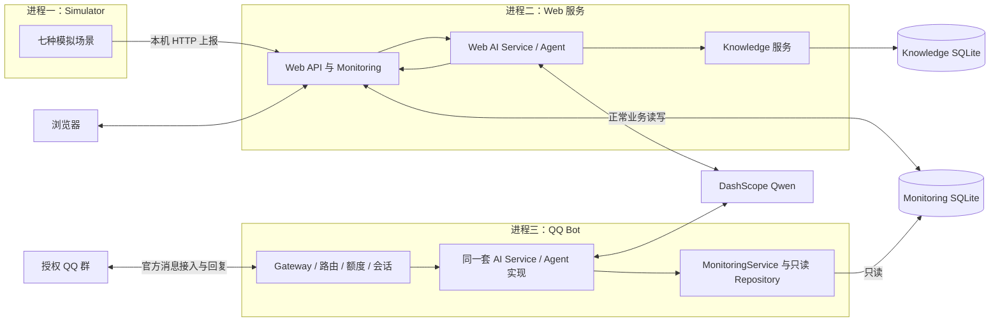
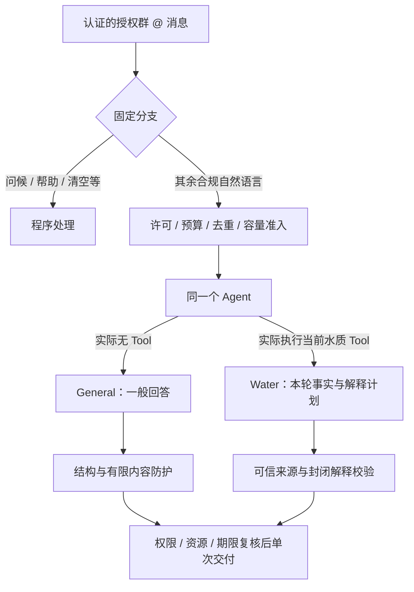
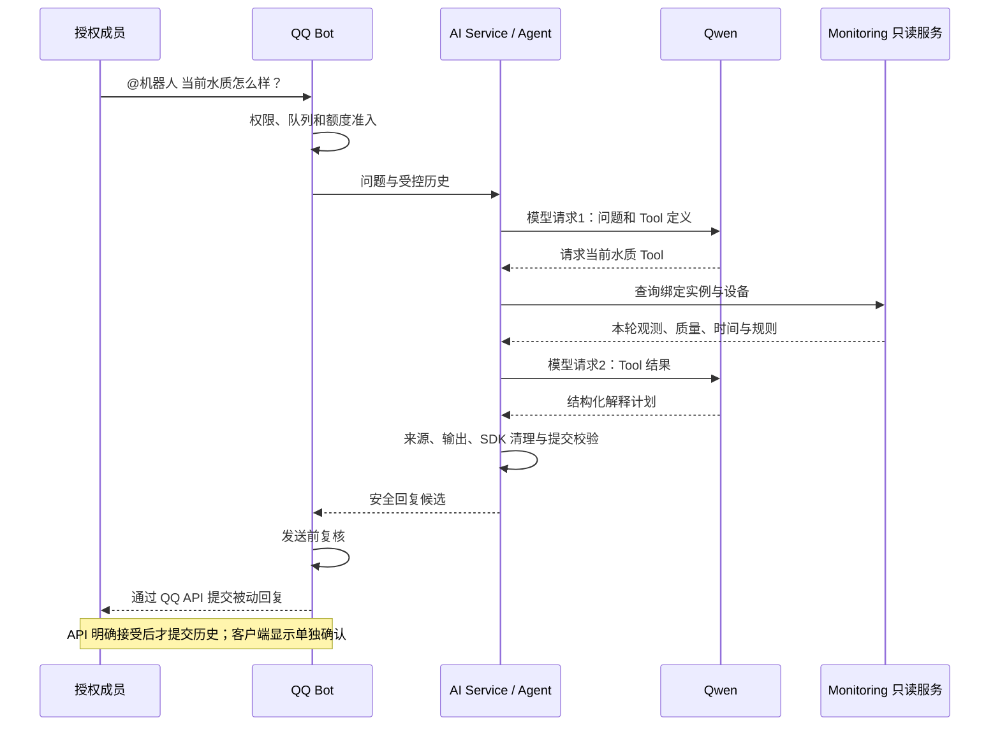

# Fishery Management — PPT Agent 制作说明

版本：初稿 v0.1，2026-10-29。事实基础为 [组员阅读版](TECHNICAL_ROUTE_TEAM.md)，对应 Management 源码基线 `87f52a7`。

本文是供制作 PPT 的 Agent 读取的内容与制图说明，不是已生成的幻灯片。仅凭本文即可确定汇报主线；需要补充细节时再查链接，不自行创造技术成果、测试数字或实验截图。

## 1. 给制作 Agent 的任务

请为 Fishery Management 制作一份中文技术路线汇报 PPT，面向指导老师与项目组成员。默认 **12页正文，约10～12分钟**，另可附2页技术备查；这是建议规模，可随汇报要求调整。

核心结论：

> 项目将统一监测服务、规则分析和已有 AI Agent 连接起来，通过 Web 与 QQ 提供可查看、可追溯、受权限和预算约束的监测管理与问答能力。

讲述顺序为：**需求 → 总体架构 → 监测事实 → Agent 问答 → QQ 多轮交互 → 运行保护 → 验证与局限**。

请突出系统集成与工程实现，不把本项目描述为新训练的大模型、原创通用 Agent 框架或已部署的自动化养殖控制平台。章节标题使用业务含义，不直接用 BOT-3G、M1 等研发阶段编号。

封面汇报人、组员、学校、课题正式名称和日期由用户确认；缺失时用明确占位，不编造身份或机构。

## 2. 事实范围与证据规则

### 2.1 两个项目如何出现在 PPT 中

- **Management 是本次汇报主体。** 描述它当前实际拥有的功能和运行方式。
- **Prototype 是实验开发与验证项目。** 只在研发流程中说明“实验验证 → 人工验收 → 选择性同步”，不是 Management 的运行依赖。
- 不能把 Prototype 的研究脚本、实验次数、延迟、费用或人工审核功能直接算作 Management 已完成成果。

### 2.2 可使用的技术事实

| ID | 可表述事实 | 边界 / 证据类型 |
|---|---|---|
| F01 | 当前演示数据来自 SIMULATOR，包含水温、pH、溶解氧和视觉统计 | 当前代码与配置合同；不是真实传感器或真实视频识别 |
| F02 | 默认每10秒形成一个窗口，水质采样间隔1秒、视觉统计采样间隔0.5秒 | 默认参数，不是模型响应时间或硬件采样性能测量 |
| F03 | Monitoring 负责校验、存储、数据质量/时效判断和领域规则 | 规则与事件不是由 Qwen 自行创建 |
| F04 | Web 提供当前指标、历史趋势、事件、知识管理及 AI 界面 | 实际权限与启动参数决定可用能力，不代表 QQ 同样开放 |
| F05 | 后端采用 Python/Flask，前端为原生 HTML/CSS/JS，业务存储为 SQLite | 不要画成 React、Vue、云原生集群或 Redis 架构 |
| F06 | Web 与 QQ 复用已有 AI Service、Agent Runtime、Tool Calling | 同一套代码分别装配到独立进程，不共享会话对象 |
| F07 | QQ 使用官方 Gateway 收群 @ 事件，通过官方 HTTPS API 被动回复 | 本轮成果不包括主动群告警推送 |
| F08 | 固定指令、有限问候、帮助、清空会话由程序处理；其余授权自然语言进入 Agent | 未授权消息、未知斜杠指令等仍受拒绝规则限制 |
| F09 | General 常规成功路径为1次模型请求、0次 Tool；Water 为2次模型请求、1次当前水质 Tool | 是执行合同，不是模型选择正确率的统计结果 |
| F10 | Water 的事实取自本轮可信 Tool，解释经结构化合同校验 | General 没有通用逐句事实核验；不能称全部文本已验证 |
| F11 | QQ 仅开放指定实例、指定设备的当前水质只读 Tool | 没有 Knowledge/历史 AI Tool、ACK、删除或设备控制权限 |
| F12 | 多轮记忆保存在 RAM，按群、成员、实例、设备及授权等版本隔离；当前查询每轮重新执行 | 旧读数不能当本轮事实；重启不恢复记忆 |
| F13 | QQ API 明确接受且其他提交条件有效时，才写入成功历史 | API 接受不等于自动证明客户端显示 |
| F14 | QQ Bot 独立运行，使用只读 Repository，保留额度、超时和 SDK 清理门禁 | 独立进程不是完整资源沙箱；本地取消不保证远端停止计费 |
| F15 | 用户反馈 Management 正常运行，并提供了问候、能力说明及当前溶解氧回复截图 | 用户可见证据；不是全部内部状态或长期稳定性的证明 |
| F16 | M1～M3 有离线回归与兼容性记录，菜单简化有15项专项通过记录 | 如引用数字须写明阶段与范围，不称“当前全部测试仅15项” |

依据与细节见 [组员版第2～8节](TECHNICAL_ROUTE_TEAM.md)。本文没有新运行模型或测试来生成额外证据。

### 2.3 数字使用规则

主页面优先用已确认的功能和流程说明价值。不要自行补“准确率99%”“响应提升数倍”“支持无限用户”“低成本生产可用”等数字。

性能、模型效果、Token 或费用图表，必须有**同项目、同版本、同工作负载**的报告支持，并写清样本数和测量范围。没有可用报告就不画定量效果图；可以展示验证维度和用户可见案例。

默认运行上限可用于解释约束，但不能当成性能成绩：30分钟、5个付费 AI Turn、每轮最多2次模型请求、每请求512输出 Token、每轮90秒、零重试。预算见备查页，不宣称8.02元是实际花费。

## 3. 逐页制作卡片

### S01 封面：智慧渔业监测管理与 QQ AI 助手

- **本页结论：**我们完成的是监测业务与受控 AI 交互的集成原型。
- **屏幕要点：**项目名称；“监测事实 × 规则分析 × 自然语言交互”；汇报人/日期占位。
- **视觉：**简洁的“监测数据 → 管理平台 → Web / QQ”概念图。不要用实物设备照片暗示硬件已接入。
- **讲解备注：**先说明数据演示为 SIMULATOR，后续详细介绍 Agent 和业务服务如何协同。
- **事实依据：**F01、F04、F06；[组员版开头](TECHNICAL_ROUTE_TEAM.md)。

### S02 需求：数据看得见，也要问得清楚

- **本页结论：**展示数据、理解变化和便捷问答需要统一起来。
- **屏幕要点：**集中查看水质与异常；理解历史变化和数据可靠性；在 QQ 中直接提问。
- **视觉：**三列“用户问题 → 系统能力”卡片，不放完整功能清单。
- **讲解备注：**不只回答“数值多少”，还要说明这个数值是什么时间、什么来源、是否可用。
- **事实依据：**F03、F04；[组员版第1节](TECHNICAL_ROUTE_TEAM.md)。

### S03 总体架构：三个独立进程，两种用户入口

- **本页结论：**Simulator、Web、QQ Bot 各自运行，业务事实保持一致。
- **屏幕要点：**Simulator 上报；Web/Monitoring 管理事实；独立 Bot 只读查询并调用同一套 Agent 实现。
- **视觉：**使用第4节 G01 架构图；画清数据库读写方向与 Qwen 外部调用。
- **讲解备注：**同一套 Agent 代码在两个进程中分别运行，不是建立第二套框架，也不是所有请求都转发给 Web AI HTTP 接口。
- **事实依据：**F05、F06、F11、F14；[组员版第2节](TECHNICAL_ROUTE_TEAM.md)。

### S04 数据链路：从模拟窗口到可信监测事实

- **本页结论：**先验证观测，再存储和分析，不让模型猜现场数据。
- **屏幕要点：**场景生成水质/视觉统计；HTTP 上报与批次校验；Monitoring 评估质量、时间与规则并保存。
- **视觉：**四步流水线，每个窗口附“来源、时间、质量”标签。10秒只标在观测窗口上。
- **讲解备注：**Seed 用于复现生成过程；场景不直接规定事件状态。查询不会重新采样。
- **事实依据：**F01～F03；[组员版第3节](TECHNICAL_ROUTE_TEAM.md)。

### S05 Web：把读数、趋势与异常放在同一视图

- **本页结论：**网页帮助用户同时观察当前读数、历史变化和需要关注的风险。
- **屏幕要点：**当前指标及数据状态；历史趋势；异常事件摘要与详情。
- **视觉：**一张经过授权的管理页面截图，最多三个局部标注。素材未提供时按第5节使用明确占位。
- **讲解备注：**展示异常时明确它是规则信号。若提到视觉三窗口恢复，需标为实验性视觉策略，不能套用到全部水质规则或疾病治愈。
- **事实依据：**F03、F04；[组员版第3.4节](TECHNICAL_ROUTE_TEAM.md)。

### S06 Agent：复用已有执行流程，通过工具获取业务数据

- **本页结论：**语言模型理解问题，程序控制工具和数据访问。
- **屏幕要点：**AI Service 装配权限；Agent 执行 Tool Calling；Monitoring/Knowledge 提供业务证据。
- **视觉：**三层图“渠道 → AI Service / Agent → 授权 Tool”；旁列 Web 与 QQ 的工具范围差异。
- **讲解备注：**Web 可在既有授权下使用当前水质、历史及知识检索；QQ 当前只开放当前水质。Knowledge 检索是本地 TF-IDF，不是新训练模型或向量数据库方案。
- **事实依据：**F06、F11；[组员版第4.1节](TECHNICAL_ROUTE_TEAM.md)。

### S07 Hybrid：普通概念直接解释，当前状态必须查工具

- **本页结论：**同一个 Agent 支持 General 和 Water，但两者的事实要求不同。
- **屏幕要点：**“你好”走程序；“什么是溶解氧”通常走 General；“现在溶解氧多少”走 Water。
- **视觉：**第4节 G02 分支图；可用两条并列问题卡片强调1请求/0 Tool与2请求/1 Tool。
- **讲解备注：**分支按实际 Tool 执行记录确定，不靠模型自行声明。General 的有限防护不是全面事实认证。
- **事实依据：**F08～F10；[组员版第4.2～4.3节](TECHNICAL_ROUTE_TEAM.md)。

### S08 一次问答：两次模型请求与一次可信查询

- **本页结论：**Water 回答由本轮观测支撑，模型不能随意补数值。
- **屏幕要点：**模型提出 Tool 请求；程序查询绑定设备；模型返回解释计划，程序校验与渲染后提交 QQ。
- **视觉：**第4节 G03 时序图，标注“模型请求1 / Tool / 模型请求2”；图太宽时拆成横向5步。
- **讲解备注：**SourceSummary 来自同一轮工具执行，不是从模型文字猜出来，也不是回答后另查一份数据补上。无效解释降级或拒绝。
- **事实依据：**F09、F10、F13；[组员版第5节](TECHNICAL_ROUTE_TEAM.md)。

### S09 多轮追问：记住话题，不沿用旧读数

- **本页结论：**上下文帮助理解追问，每轮当前事实仍需重新查询。
- **屏幕要点：**按群/成员/实例/设备等隔离；成功交付后提交内存历史；清空、到期或重启后不继续使用失效记忆。
- **视觉：**两轮对话示意：“现在水质怎么样？”→“那溶解氧呢？”，第二轮再画一条 Tool 查询箭头。无截图时注明“交互流程示意”。
- **讲解备注：**示意不是新真实聊天证据。API 接受与客户端实际显示是两种证据；未知交付不能写入成功历史。
- **事实依据：**F12、F13；[组员版第5节](TECHNICAL_ROUTE_TEAM.md)。

### S10 运行保护：权限、额度与进程边界

- **本页结论：**自然语言交互不能取得无限调用或业务写权限。
- **屏幕要点：**绑定群/成员/设备与只读 Repository；一次批准有限 Run、逐轮预留；SDK 清理与单次交付门禁。
- **视觉：**三道边界卡片“谁能问 / 能查什么 / 何时停止”，旁画 Bot 与 Web 独立进程。
- **讲解备注：**不要把独立进程说成完整资源沙箱；取消不保证远端立即停止计费。主页面无需列所有 Token、锁、文件名或长 Scope 哈希。
- **事实依据：**F11、F14；[组员版第6节](TECHNICAL_ROUTE_TEAM.md)。

### S11 验证成果：离线合同测试与真实可见交互

- **本页结论：**系统已有工程测试与真实交互证据，仍需继续验证长期运行。
- **屏幕要点：**Fake/Mock 验证主要正常和故障路径；Management 用户确认 QQ 回复可见；Web/Simulator/Bot 可独立编排。
- **视觉：**左侧验证维度表，右侧一张脱敏 QQ 截图；如截图未归档则使用明确占位，不伪造聊天气泡。
- **讲解备注：**截图证明对应回复可见，不能独立证明完整内部状态。若没有同版本量化报告，不放响应速度、正确率或费用的成绩图。
- **事实依据：**F15、F16；[组员版第8节](TECHNICAL_ROUTE_TEAM.md)、[M1](deep-dive/M1_SHARED_SAFETY_ACCEPTANCE.md)、[M2](deep-dive/M2_QQ_HYBRID_OFFLINE_ACCEPTANCE.md)、[M3](deep-dive/M3_MANAGEMENT_STACK.md)。

### S12 总结与后续：先完成可追溯问答，再扩展真实场景

- **本页结论：**现阶段完成监测管理与受控 QQ Agent 原型，下一步按证据逐项扩展。
- **屏幕要点：**统一业务事实；复用 Agent 与多渠道；继续研究真实传感器、回答质量和长期部署。
- **视觉：**左侧“当前实现”，右侧“后续研究”；后续使用虚线，不与已实现模块混画。
- **讲解备注：**真实摄像头/NPU、自动设备控制、主动群通知等不作为已完成功能。不要用“全自主闭环控制”收尾。
- **事实依据：**[组员版第8～9节](TECHNICAL_ROUTE_TEAM.md)。

### 可选备查页（不占正文主线）

- **A01 技术与模块索引：**Python/Flask、原生前端、SQLite、官方 QQ Gateway、Qwen、TF-IDF；给出模块职责，不贴源码长截图。
- **A02 演示入口与实验额度：**两条 CMD、一张预算表、停止方式与数据来源说明。每轮预留1.602765元、默认总预留8.02元不是实际账单；完整操作留在文档。

## 4. 制图规范与可复用底稿

### G01 总体架构图（S03）

画图检查：Bot 不连 Knowledge；Qwen 不直接连数据库；QQ Bot 不画入 Monitoring 写入循环。两个 Agent 节点用相同形状，标注“共享实现、分别运行”；Qwen 画在本机进程框外。图表示三终端使用同一 Monitoring 实例的情况，不能把两终端另一份演示库混进去。

### G02 Hybrid 路由图（S07）

“通常1次 / 最多2次”标在相应 AI 分支，不标在问候上。程序固定查询仍按自身能力执行；不将所有固定分支都画成不访问业务数据。

### G03 Water 问答时序（S08）

可以重绘为 PPT 可编辑图形，但不得改变连接方向、工具次数和来源条件。不要将 Mermaid 源码作为页面正文，也不要把无法辨认的全页架构缩略图当成主要内容。

## 5. 素材清单与取得方式

| 素材 | 用途 | 当前可用性 / 处理方法 |
|---|---|---|
| 管理首页、历史趋势、事件页截图 | S05 | 本次文档未生成或读取新截图；由用户提供授权的演示素材，保留 SIMULATOR 标识 |
| Management QQ 回复截图 | S11 | 用户在本次会话提供过；若制作 Agent 未拿到原图，须请用户提供，不假设其在仓库中 |
| 两轮追问截图 | S09或备查 | 必须核对来源项目；只有 Prototype 素材时标注 Prototype，不改称 Management 验收 |
| 架构图、路由图、时序图 | S03/S07/S08 | 本文 G01～G03 可直接重绘，无需真实数据 |
| 定量性能 / 正确率 / 费用图 | 可选备查 | 本文未提供可直接引用的数据集；缺证据则省略，不用示例值填充 |
| 运行命令 | A02 | 见 [BUILD_RUN](BUILD_RUN.md)，只展示入口，不把运行配置正文放入 PPT |

素材缺失时：草稿可显示“待补：Management 首页截图”等明确占位，最终交付清单须注明；不制造逼真的假截图替代验收证据。流程示意图可以自制，但应标为“示意”。

截图应遮去真人昵称、头像、群名、完整 OpenID、密钥、Token、私有路径及非必要业务信息。尽量保留来源、观测时间、质量和过期说明，不能为了美观裁掉会改变读数含义的限制条件。不要自行从 `outputs/`、私有存储或业务数据库搜集素材。

## 6. 页面表达与讲解要求

- 默认16:9。白色或浅色背景，深色正文，蓝绿色表示业务模块，蓝色表示交互入口，橙色用于需要关注的状态；保持全文含义一致。
- 每页一个结论、最多三个主要要点，优先用结构图、对照图和授权截图；不要把组员文档整段搬上页面。
- 中文为主，首次出现 Agent、Tool Calling、Monitoring 等词时给简短解释。Scope、RunConsent、SDK 线程细节放备注或备查，不占用所有主页面。
- 建议标题28～36pt、正文20～24pt；复杂表格应缩减内容或拆页，不以极小字号塞满。
- 每页备注至少包含讲解逻辑、事实边界和来源标识。源码文件名可放备注，不在页面正文堆满路径。
- 不需要给每页加大段免责声明；但“模拟数据”“实验性 General”“未接真实硬件”等会改变结论的信息，应在相关页面直接可见。
- 命令仅用于用户手动演示。制作 PPT 不授权启动服务、运行真实 QQ/Qwen、读取凭据、查询正式库或消费运行批准。

## 7. 不得出现的成果表述

| 不采用 | 使用准确表述 |
|---|---|
| 已实现真实摄像头识别 / NPU 部署 | 当前演示使用模拟水质与视觉统计，真实接入属于后续研究 |
| AI 自动确诊、开药或控制增氧设备 | 规则识别异常信号，AI 提供受控解释；无相关写入或控制 Tool |
| General 回答都经过现场事实验证 | General 是有限防护的一般回答；Water 才绑定本轮 Monitoring 事实 |
| 已通过 QQ 开放项目 RAG / 历史分析 | Web 有已授权知识/历史能力，当前 QQ AI 仅开放当前水质 |
| Web 与 QQ 使用两个独立开发的 Agent 框架 | 复用同一套实现，在独立进程中装配 |
| 已完成生产发布、无限会话、完全防注入 | 当前为有界实验运行；模型质量、安全和长期稳定性仍需验证 |
| 本轮10秒生成窗口，所以机器人10秒以内响应 | 采样窗口与模型/网络延迟是不同指标，没有对应测量就不作结论 |
| API 接受就是客户端送达；8.02元就是实际成本 | 接受与显示分别取证，预留预算与最终账单分开 |

## 8. 制作者最终交付与自查

建议交付可编辑幻灯片、逐页讲稿、素材/证据清单及缺失素材说明；如工具支持，可附 PDF 预览。不要把本文当作已经生成 PPT 的证明。

交付前逐项检查：

1. 12页主线完整，封面身份由用户确认，页面中没有未说明的虚构成果或占位数据。
2. Management 与 Prototype 清楚区分，所有已实现/已验证/待研究标识一致。
3. 架构图明确三个进程、两个用户渠道和一套 Agent 实现；数据库读写方向正确。
4. General 与 Water 的工具、来源、发布可信度没有混淆；第二轮当前查询仍画了新 Tool 调用。
5. SIMULATOR、过期、缺测等说明没有在截图或文字简化中消失。
6. 所有测试/性能数字均有明确项目、版本、日期、样本与来源；缺证据的量化图已删去。
7. QQ 平台接受与客户端显示分开描述；预算不写成实际账单。
8. 不含密钥、完整平台身份、原始敏感请求、批准文件或业务记录正文。
9. 字体、换行、图形连接、截图可读性和页面边界逐页检查；如制作工具支持渲染，应查看导出后的实际效果。
10. 列出仍待用户提供或确认的素材，不用假截图或无依据数字掩盖缺口。

## 9. 配套阅读

- [组员技术路线说明](TECHNICAL_ROUTE_TEAM.md)：详细原理、边界和源码入口。
- [启动指南](BUILD_RUN.md)：两终端/三终端和场景选择。
- [组员首次配置](deep-dive/MANAGEMENT_HANDOFF.md)：项目文件夹交接注意事项。
- [M1](deep-dive/M1_SHARED_SAFETY_ACCEPTANCE.md)、[M2](deep-dive/M2_QQ_HYBRID_OFFLINE_ACCEPTANCE.md)、[M3](deep-dive/M3_MANAGEMENT_STACK.md)：共享基础、独立 Bot 与运行编排的阶段证据；其中历史结论按当时阶段解释。

若其他材料与组员版或当前源码冲突，先列出矛盾并请用户确认，不自行选择更夸大的版本。新增加的性能、硬件或功能成果，应先补足对应证据，再修改 PPT 内容。
