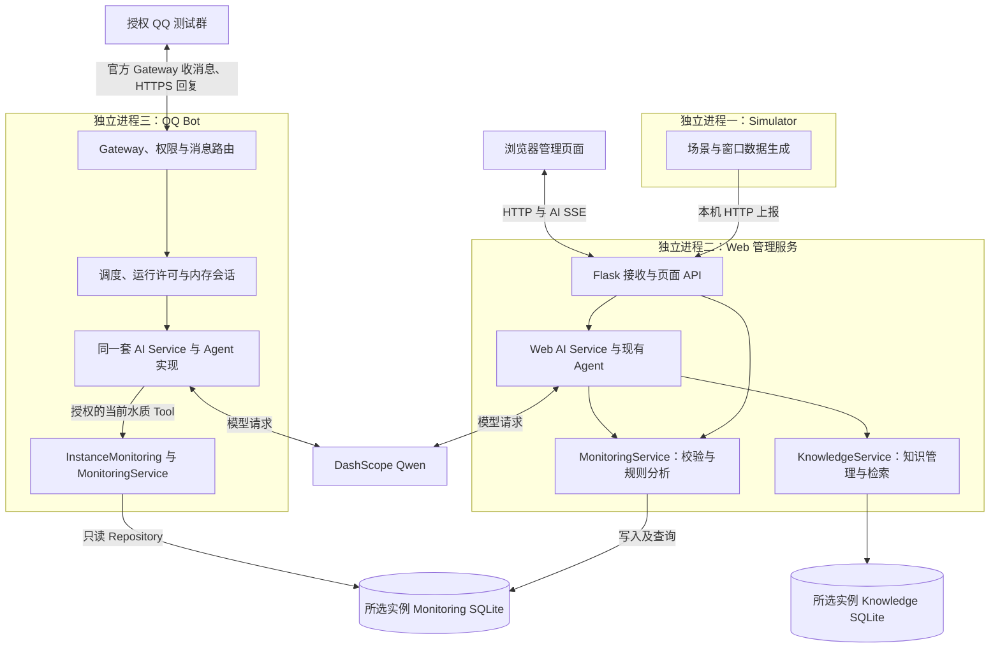
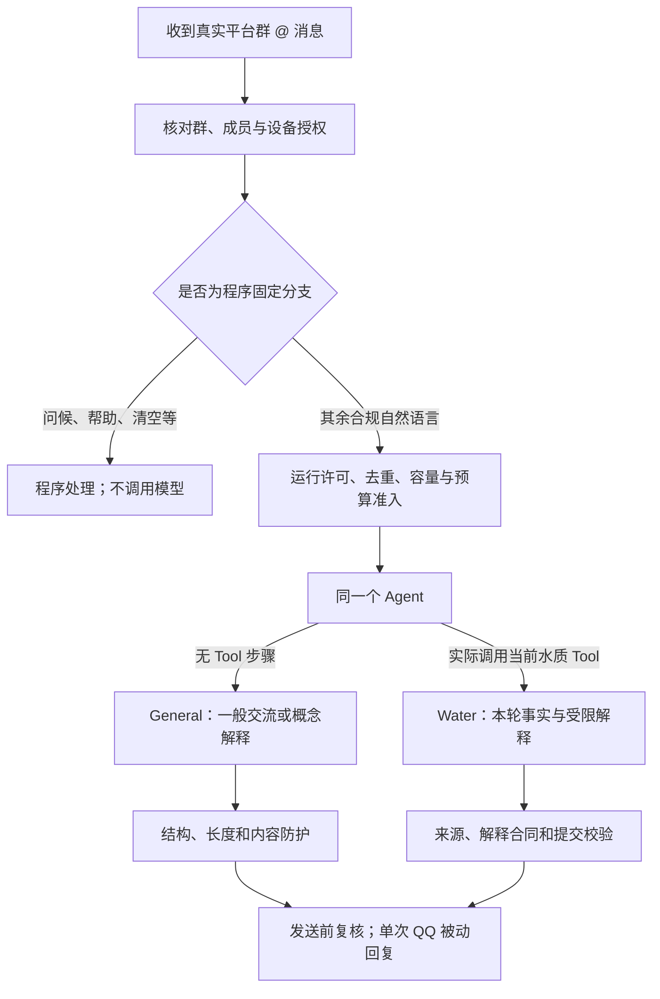
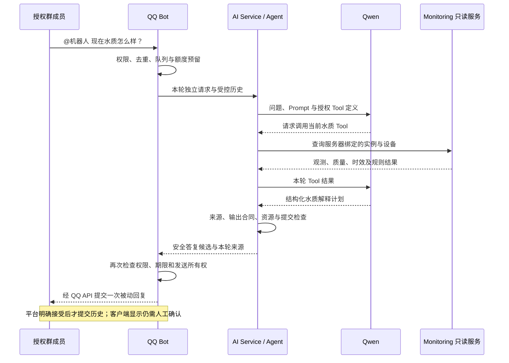

# Fishery Management 技术路线说明（组员阅读版）

版本：初稿 v0.1，2026-10-29。依据 Management 源码 `87f52a7`、现有 M1～M3 文档及用户提供的真实 QQ 运行反馈整理。面向项目讲解、演示和后续 PPT 内容讨论，不是安装教程或生产发布证明。

## 先用一分钟了解项目

本项目把**监测数据、规则分析、Web 管理和 QQ AI 问答**连接起来：模拟器产生观测数据，Monitoring 负责校验、存储和规则分析；用户既能在网页查看水质、趋势与事件，也能在 QQ 群询问当前水质或解释相关概念。

AI 不直接打开数据库，也不直接控制设备。需要现场信息时，现有 Agent 通过授权的只读工具查询 Monitoring，再将可信事实与模型解释组合成回复。

当前演示使用 **SIMULATOR 合成数据**。视觉页面展示的是模拟统计，尚未在这个 Management 项目中接入真实摄像头、视觉识别模型或 NPU。QQ 问答链路已有真实 QQ + Qwen 人工运行反馈，但仍是有界、受控的实验性功能。

可以用这句话介绍技术路线：

> 用统一的监测服务管理事实，用可追溯的规则识别异常，用已有 Agent 调用只读工具，并通过 Web 和 QQ 两个渠道帮助用户理解数据。

## 1. 我们解决什么问题

| 用户需要 | 系统提供的能力 |
|---|---|
| 方便查看鱼塘情况 | 网页展示水温、pH、溶解氧、视觉统计和数据状态 |
| 看变化而不是只看一个数 | 历史趋势、时间范围筛选和异常事件记录 |
| 判断数据是否值得参考 | 展示观测时间、质量、新鲜度、在线状态与缺测情况 |
| 用自然语言理解信息 | Web AI 助手，以及 QQ 群中的概念解释和当前水质问答 |
| 控制外部模型调用风险 | 明确授权对象、只读工具、调用预算、超时和资源清理 |

这里的“异常”是实验规则识别出的信号，不等于专业诊断；“未触发规则”也不等于已经证明适合养殖或鱼群健康。

## 2. 系统由哪些部分组成

### 2.1 总体架构



图中的两个 Agent 节点代表**同一套代码在两个进程中分别装配**，不是两套 Agent 框架，也不是共享一个会话对象。QQ 查询 Monitoring 时，在 Bot 进程内调用服务层并只读访问指定数据库；当前没有另建内部 HTTP AI 服务或 Redis。

### 2.2 主要技术选择

| 部分 | 当前技术 | 作用 |
|---|---|---|
| 应用后端 | Python 3.11+、Flask | 页面接口、业务协调和本机服务 |
| 前端 | 原生 HTML/CSS/JavaScript、SVG 图表 | 管理页面、趋势图和交互；无需前端打包服务 |
| 数据存储 | SQLite | 保存监测数据、事件及独立知识内容 |
| AI 执行 | 现有 AI Service、Agent Runtime、Tool Calling | 组织模型请求和受控工具执行 |
| 模型接入 | OpenAI-compatible SDK、httpx、DashScope Qwen | 对接外部语言模型；当前 QQ 配置为 `qwen3.8-flash` |
| 知识检索 | 本地 TF-IDF 检索 | 为已授权的 Web 知识问答提供文本证据 |
| QQ 接入 | 官方 WebSocket Gateway、HTTPS API | 接收群 @ 事件并进行被动回复 |
| 运行编排 | Windows PowerShell、独立终端和进程管理 | 启动、观察日志与回收本次进程 |

Node 用于前端离线测试，不是另一个必须启动的业务服务。当前没有训练自己的大语言模型；主要工作是将已有模型、业务数据与可控执行流程集成起来。

## 3. 监测数据怎样进入系统

### 3.1 从模拟场景到观测窗口

Simulator 按场景的时间变化生成水温、pH、溶解氧，以及可见鱼数、行为和异常信号等视觉统计。默认配置下，每10秒形成一个窗口，窗口内水质采样间隔为1秒、视觉统计采样间隔为0.5秒，再计算均值、最小值、最大值及计数等字段。

固定 Seed 可以复现随机生成过程，适合调试和对照实验。模拟器输出的是**观测数据**；是否触发规则、是否生成事件，由 Monitoring 判断，不由场景直接写死事件状态。

当前菜单有七种场景：正常水质、低溶解氧、疑似疾病信号、摄食减少、复合异常、设备离线，以及溶解氧快速下降后逐步回升。

### 3.2 上报、校验与存储

数据经过本机 HTTP 接口进入 Web 服务，携带启动时生成的模拟接入 Token。Monitoring 校验设备、报文、时间和数据结构，再由 Repository 在事务中保存数据与事件变化。Session、Sequence 和 Batch ID 用于区分观测会话、顺序和批次，支持重复上报识别及顺序处理。

网页和 AI 工具都通过 Monitoring 服务理解数据，避免各自复制一套阈值或维护两份“当前状态”。网页刷新或模型调用工具只是查询，**不会重新采样，也不会让旧观测自动变新**。

### 3.3 一个读数必须带着它的条件

| 信息 | 通俗含义 | 为什么重要 |
|---|---|---|
| 来源 | 当前演示为 SIMULATOR | 不能称为真实传感器测量 |
| 观测时间 | 数据反映哪个时间窗口 | 与“现在发起查询”不是一回事 |
| 接收时间 | 服务何时收到数据 | 可帮助区分采集与传输过程 |
| 评估时间 | 服务何时判断数据状态 | 查询时可以重新评估旧数据是否过期 |
| 质量 | 有效、部分有效、无效或缺测 | 不能把缺失值补成0或称为正常 |
| 新鲜度与连接状态 | 新鲜、过期、未知；在线、离线等 | 留存读数不能冒充当前实时状态 |

例如，停止模拟器后，数据库仍可能保留上一次溶解氧读数。系统可以显示这个历史值，但应同时说明过期或离线，不能凭它确认当前低氧或当前正常。

### 3.4 规则与事件

Monitoring 用确定性的领域规则评估观测，再维护异常发生、持续和消退等生命周期。风险周期的列表摘要与详情保留不同层次的信息：列表便于看当前风险，详情用于追踪等级变化与原始证据。

视觉异常采用连续三个可靠 CLEAR 窗口确认信号消退，避免一个随机零检测窗口就反复关闭、重建事件。缺测、离线或观测中断不能当作可靠恢复；这个三窗口参数仅是本地实验策略，不是疾病治愈标准，也不是所有水质规则的统一恢复条件。

事件结论来自 Monitoring，**不是 Qwen 自行生成的异常事件**。管理页面具体开放的维护操作属于本机管理能力，不能因此推断 QQ 或 AI 也有相同写权限。

## 4. AI 如何回答：已有 Agent + 授权工具

### 4.1 三层分工

| 层 | 负责什么 | 不负责什么 |
|---|---|---|
| AI Service | 绑定模型、设备、权限、请求和来源要求 | 不另造业务规则 |
| Agent Runtime | 执行模型 → 工具 → 模型的既有流程，管理请求、取消和结果提交 | 不因为聊天指令而自行扩大权限 |
| 业务 Tool | 调用 Monitoring 或已授权的 Knowledge 服务，返回受控事实 | 不让模型任意执行 SQL、访问文件或控制设备 |

Web 与 QQ 复用这些底层能力，但装配范围不同。Web 在已有许可与 Policy 下可使用当前水质、历史水质、知识检索等能力，并支持 Normal/Streaming；QQ 首版只开放当前水质 Tool，不能自动继承 Web 的工具和权限。

Web 知识问答使用项目知识库检索；QQ 的 General 概念回答来自语言模型的一般知识，**不等于调用了项目知识库**。

### 4.2 Hybrid：程序处理固定事项，Agent 决定是否查水质



这里没有为每一种水质问法不断增加关键词，也没有再调用一个模型做意图分类。程序只保留有限的固定分支；其他授权自然语言进入原 Agent，由模型在已注册工具范围内选择。

最终按**实际工具执行记录**区分 General 和 Water，不能仅相信模型说“我是一般聊天”就跳过来源检查。

### 4.3 两类回答的可信程度不同

| 分支 | 典型问题 | 常规成功路径 | 输出边界 |
|---|---|---|---|
| General | “什么是溶解氧？” | 1次模型请求、0次 Tool | 简短概念解释；不代表现场核验或逐句事实认证 |
| Water | “现在鱼塘溶解氧是多少？” | 2次模型请求、1次当前水质 Tool | 本轮数值、时间、质量与规则只取自可信 Tool 结果 |

Water 中，模型输出受限的结构化解释计划，程序核对指标、来源、规则和允许的建议，再依据同轮 SourceSummary 渲染。模型不能在解释里随意添加读数、编造规则命中或宣称已执行增氧操作。合同不合格时会降级或拒绝，不能直接放行原始模型正文。

日常 Chat 展示突出用户询问的指标，并保留必要的模拟来源、时间、缺测和异常说明。详细 A/B/C 展示用于区分系统事实、模型解释、来源与限制；两者不需要额外调用模型或重新读取数据库来补写来源。

General 采用另一套结构与有限内容防护，允许自然交流，但没有实现通用事实核验器。两条分支不能混称为“所有 AI 内容均已验证正确”。

## 5. 一次 QQ 水质问答的完整过程



问“那溶解氧呢？”时，历史用于理解正在讨论水质，但新一轮仍需读取当前数据。历史里的旧读数不能生成本轮工具回执，也不能成为新的“实时水质”。

会话保存在内存中，按 App、群、成员、实例、设备及权限/Scope 等版本隔离。当前默认最多保留每会话6个成功 Turn，空闲15分钟过期，最多64个会话，另有内容大小和历史投影限制。Bot 重启后不恢复聊天记忆。

只有 QQ API 明确接受了实际安全回复，且权限和会话版本仍有效，才提交成功历史。超时、取消、送达未知或失败均不能当作成功对话；`/清空会话` 不影响其他成员，也不恢复模型额度。

## 6. 如何避免影响原管理系统

### 6.1 独立进程与只读数据边界

QQ Bot 可独立启动或停止，不是 Web 和 Simulator 的启动依赖。Bot 自己的 SDK 故障隔离状态不会变成 Web 进程的隔离状态；但三者仍共用一台机器，并不是完整的操作系统资源沙箱。

Bot 只能通过可信本机配置选择实例与设备，Repository 明确使用 SQLite `mode=ro`、`query_only` 和写操作限制，并对查询设置资源预算。缺库、Schema 不兼容或损坏时拒绝，不自动新建、升级、修复或切换到另一实例。模型和 QQ 消息正文不能修改这些绑定。

### 6.2 一次启动批准的是有限额度

RunConsent 表示操作者批准本次进程的模型、数据披露、群、成员、实例、设备、时长和费用预留。每次合法 AI 准入再原子预留一个 TurnLease，防止并发和重复消息反复消费同一许可。

当前默认实验配置为：

| 约束 | 上限或行为 |
|---|---|
| 整次运行 | 30分钟、最多5个付费 AI Turn；批准成员共享额度 |
| 每个 Turn | 最多2次模型请求、每请求512输出 Token、90秒、零自动重试 |
| AI 调度 | 1个 AI worker，最多2个等待位置，并限制同会话并发 |
| 费用预留 | 每轮1.602765元，5轮至少8.013825元；默认总上限8.02元 |
| 许可复用 | 仅本次进程有效；不能重启恢复旧额度 |

费用数字是保守的本地准入预留，不是实际费用预测，也不是云账单绝对硬上限。失败、取消和送达未知不自动退回许可；BUSY、未授权和重复消息等不应成为新的付费执行。

### 6.3 四个容易混淆的“完成”

1. **Backend 完成：**模型与工具流程结束，不代表可以发送。
2. **资源和提交检查通过：**来源、权限、输出及本地 SDK 清理符合要求。
3. **QQ API 接受：**平台接受回复，不代表程序已经证明客户端显示。
4. **用户看见：**需要在 QQ 客户端独立确认。

SDK 清理失败时，系统保留故障隔离并停止新模型调用，不能把未退出的请求当作已安全完成。Python 仍不能保证强制终止所有不合作线程，本地取消也不保证远端模型停止计算或计费。

发送超时、结果未知时，不自动重发，也不重新推理补偿。配置、权限、Scope 或设备绑定失效时，旧任务不能继续按旧许可发送。

## 7. 演示时怎样讲、怎样运行

### 7.1 两个入口

在 Management 根目录执行，二选一：

```powershell
# 两终端：Simulator + Web
.\scripts\dev\启动演示系统.cmd

# 三终端：Simulator + Web + QQ Bot
.\scripts\dev\启动QQ演示系统.cmd
```

两种方式都在 Simulator 窗口选场景。三终端还需在 Bot 窗口人工批准；该入口关闭本次 Web AI，但保留 QQ AI。其他 Web AI 启动方式见 [启动指南](BUILD_RUN.md) 和 [运行维护参考](deep-dive/BUILD_RUN_REFERENCE.md)。

当前本机两终端使用 `outputs/demo-instance`，三终端使用 `outputs/qq-m3-real-test`；它们不是同一份数据库。三终端内部的 Web、Simulator 和 Bot 才绑定到同一隔离实例。

### 7.2 建议演示顺序

1. 先选正常场景，说明数据来自模拟器，展示网页读数、时间和历史趋势。
2. 在 QQ 问“你好”和“什么是溶解氧？”，区分程序问候与模型概念解释。
3. 问“现在水质怎么样？”再追问“那溶解氧呢？”，说明每轮重新查询，历史只帮助理解主题。
4. 正常停止后重新选“快速下降后逐步回升”，观察数据和事件变化；场景切换不靠清空数据库实现。
5. 选设备离线或停止模拟器，观察数据如何变成过期/离线，说明系统不会用旧值假装当前正常。

七种场景是启动时选择，不是当前运行中的热切换。演示要预留10秒窗口形成和新鲜度变化的等待时间，不应期待选完立刻出现完整新状态。

组员换电脑或移动目录后，应按 [首次配置说明](deep-dive/MANAGEMENT_HANDOFF.md) 重建环境和本机配置，亲自录入凭据。源码、配置、数据库和凭据是不同的交接对象；不要直接打包别人机器的密钥、正式数据库或旧批准账本。

## 8. 目前完成到什么程度

| 层次 | 已有依据 | 可以怎样表述 |
|---|---|---|
| 代码能力 | 当前源码中已有 Web、Monitoring、知识管理、模拟场景、独立 Hybrid Bot 及启动编排 | 已形成可运行的管理与问答原型 |
| 离线验证 | M1～M3 记录了 Fake/Mock、只读、故障、进程、Web/Node 和打包回归；菜单简化另有15项专项通过记录 | 核心合同和主要错误路径已有离线验证；不是生产可靠性认证 |
| 真实人工运行 | Prototype 有既往 QQ/Qwen 实验；Management 用户本轮反馈可运行，并提供问候、能力说明和当前溶解氧回复截图 | Management 已有真实 QQ 交互及模拟水质回复的用户可见证据 |
| 仍需完善 | 长时间稳定性、General 语义质量、复杂 Prompt Injection、多用户压力及真实硬件接入 | 需要继续测试和工程完善，不能推导为已全部解决 |

Prototype 的实验数字不能直接当作 Management 的性能或正确率。QQ 截图能证明用户看到了对应回复，不能单凭截图证明所有内部状态、全部失败路径或长期稳定性。本次整理没有重新连接模型、平台或业务实例。

当前没有通过 QQ 开放 ACK、删除、设备控制、Knowledge 或历史 AI Tool，也没有将主动群告警推送作为本轮已交付功能。人工审核研究功能不应因 Prototype 中存在而自动列入 Management 本次成果。

后续可以分别研究真实传感器接入、官方权限允许下的事件通知、模型回答质量评估和长期部署。这些是后续工作，不画成当前已经完成的闭环自动控制。

## 9. 汇报时避免的五种误解

| 不准确的说法 | 建议说法 |
|---|---|
| “已完成真实水下视觉监测和智能控制” | 当前 Management 演示接入模拟水质与视觉统计，真实视频、硬件控制另行研究 |
| “Qwen 自动诊断鱼病并处理” | Monitoring 按规则识别异常信号，AI 提供受控解释，不确诊、不执行控制 |
| “两个渠道各有一套 Agent” | 两个独立进程复用同一套 AI Service 和 Agent 实现，装配权限不同 |
| “所有模型回答都经过事实核验” | Water 的现场事实绑定本轮 Tool；General 仅有结构和有限内容防护 |
| “预算8.02元就是实际花费，平台接收就一定送达” | 本地费用预留与最终账单分开，平台接受与客户端显示分开 |

## 10. 想进一步了解时看哪些文件

以下为源码和文档入口，均不需要打开真实数据库或密钥。

| 想了解什么 | 入口 |
|---|---|
| 两个启动入口与组员交接 | [BUILD_RUN](BUILD_RUN.md)、[首次配置](deep-dive/MANAGEMENT_HANDOFF.md) |
| 数据生成与上报 | [generator.py](../simulator/generator.py)、[transport.py](../simulator/transport.py) |
| 监测统一事实、规则与事件 | [service.py](../monitoring/service.py)、[rules.py](../monitoring/rules.py)、[events.py](../monitoring/events.py) |
| 数据库只读边界 | [repository.py](../monitoring/repository.py)、[Monitoring 适配](../qq_bot/monitoring_source.py) |
| Web/QQ 共享 AI 装配 | [AI Service](../ai_service/service.py)、[工具 Registry](../ai_service/business_tools/registry.py) |
| Hybrid Prompt 与 General/Water 判定 | [channel_hybrid.py](../ai_service/channel_hybrid.py)、[展示合同](../ai_service/channel_presentation.py) |
| 许可、队列、交付和记忆 | [run_consent.py](../qq_bot/run_consent.py)、[ai_scheduler.py](../qq_bot/ai_scheduler.py)、[ai_delivery.py](../qq_bot/ai_delivery.py)、[conversations.py](../qq_bot/conversations.py) |
| Management 真实运行装配 | [channel_management_live.py](../ai_service/channel_management_live.py)、[M3 文档](deep-dive/M3_MANAGEMENT_STACK.md) |
| SDK 清理与资源门禁 | [sdk_resources.py](../ai_backend/sdk_resources.py)、[M1 验收](deep-dive/M1_SHARED_SAFETY_ACCEPTANCE.md) |
| Web 知识检索 | [retrieval.py](../knowledge/retrieval.py)、[知识内容说明](deep-dive/KNOWLEDGE_CONTENT.md) |
| 移植与兼容性依据 | [M2 验收](deep-dive/M2_QQ_HYBRID_OFFLINE_ACCEPTANCE.md) |

### 讲解常用词

- **Monitoring：**监测业务服务，管理观测、时间、质量和规则，不是语言模型。
- **Agent / Tool Calling：**模型提出工具请求，程序按权限实际执行并返回结果的流程；不意味着模型能任意操作电脑。
- **SourceSummary：**从本轮可信工具执行提取的来源摘要，不从模型正文反推事实。
- **Source Gate / Commit Gate：**来源检查与最终提交检查；执行结束不等于结果可以发布。
- **Scope：**绑定实现、Prompt、工具和预算等合同的范围与指纹；代码文件存在不等于具有真实运行资格。
- **RunConsent / TurnLease：**本次进程的有限运行批准，以及每轮从额度中派生的内部许可。

这份文档供组员先审阅技术事实和讲解顺序。后续 PPT Agent 版应从这里提炼页面和图示，不另行创造功能、性能数据或资格结论。
