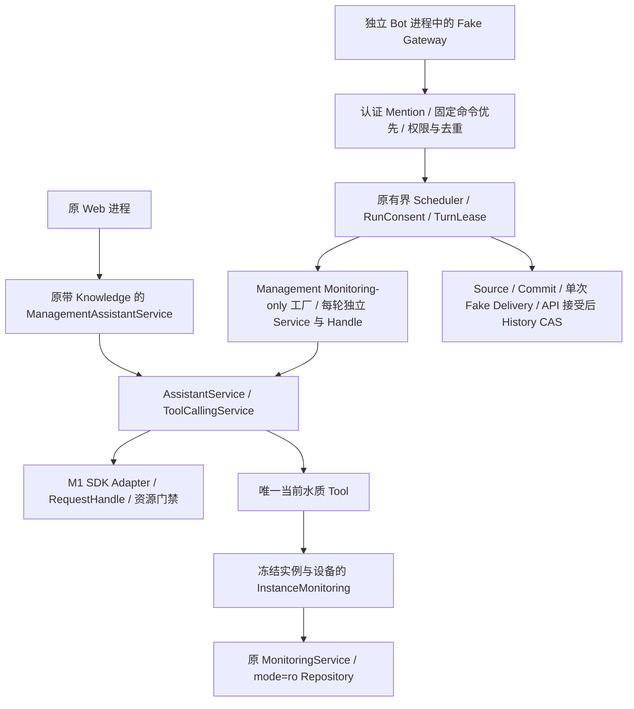

# M2：独立 QQ Hybrid Bot 离线集成与验收

核验日期：2026-10-29。范围仅为 Management；Prototype 为只读功能参考，没有复制其配置、凭据、批准或业务数据。本阶段没有进行真实 QQ/Qwen 调用。

## 1. 基线与边界

- Management 开始于 `codex/mig3-baseline / 77b660d0a59f09131972e7f29b718df0926ed888`，工作树干净。相对审计时 HEAD，新增提交仅为 M1 的已验收变更。
- Prototype 参考版本为 `main / dcb70a243199f3e534904b8d7fd99d323feacc6f`，工作树保持干净。
- 原 M1 基线为 609 Python / 116 Node；本轮另外从 Management HEAD 的只含 Git 跟踪文件快照重新运行基线，避免把新功能测试当成原基线。
- 使用 Management 自身 `.venv`：Python 3.12.14、openai 2.54.0、httpx 0.28.1、Flask 3.1.3。没有安装或升级依赖。
- 没有修改 Backend、Monitoring Repository/Schema/规则、Knowledge、Web 页面/API、Simulator 或原启动器。M1 的线程启动前超时租约修复保留原字节。

## 2. 实际调用链



这里共享的是源码和原 Agent 实现。独立进程各自拥有 SDK 资源预算、线程和内存会话，Bot 隔离不改变 Web 进程的 SDK 状态。没有把模型线程放入监测循环，没有复制 Agent 或 Tool 循环。

## 3. 最小共享改动

`ai_service/service.py` 增加内部 Monitoring-only 工厂、类型化渠道授权及历史装配，执行仍使用原 `AssistantService`、`ToolCallingService` 和 M1 Adapter。原构造入口仍要求 Knowledge；Web 没有传入新增内部参数，默认 Prompt、工具选择、Normal/Streaming 和公开请求 DTO 不变。

`ai_service/contracts.py` 只给内部 Prepared Turn 增加两个默认 None 字段。没有新增 Web 路由或公开参数。Bot 工具 Registry 仅注册 `get_current_water_quality`，运行时继续取 Management Policy 交集，并在 Tool、模型 I/O、发送、历史提交和 watchdog 等时间边界复核。

## 4. 新增文件职责

| 文件组 | 本阶段用途 |
| --- | --- |
| `qq_bot/__init__.py`、`__main__.py` | 独立包入口；默认及 `--check` 都返回禁用状态 |
| `qq_bot/contracts.py`、`configuration.py`、`adapter.py`、`service.py` | 严格本机访问配置、单设备绑定、权限/去重/限流、固定当前水质查询 |
| `qq_bot/gateway.py`、`transport.py` | Gateway 心跳/恢复及安全 URL 策略；M2 仅允许 Mock HTTP 和注入的 Fake 连接 |
| `qq_bot/monitoring_source.py` | 显式本机实例、设备白名单、文件身份复核；仅当前水质/devices/bind 的只读 facade |
| `qq_bot/ai_configuration.py`、`ai_coordinator.py`、`ai_scheduler.py`、`ai_delivery.py`、`ai_routing.py` | 授权代次、原子任务准入、有界执行/取消、单次交付及实际发送文本交接 |
| `qq_bot/conversations.py`、`hybrid_conversations.py`、`intent.py`、`hybrid_intent.py` | RAM 历史、真实 Mention 证明、免费程序分支及 Hybrid 路由 |
| `qq_bot/run_consent.py`、`session_run.py`、`hybrid_run.py`、`trial_configuration.py` | 当前进程许可/独占所有权、fsync 额度账本、每轮私有 Service/Handle、显式本机配置快照 |
| `ai_service/channel.py`、`channel_conversation.py`、`channel_hybrid.py` | 内部渠道授权、可信历史快照、实际 Tool Steps 决定 General/Water 分支 |
| `ai_service/channel_scope.py`、`channel_trial.py`、`channel_conversation_trial.py`、`channel_session_run.py` | 复用预算/SDK/历史合同的最小支持层；本次没有迁移真实试用 CLI 或资格入口 |
| `ai_service/channel_validation.py` | 仅同一次无 I/O 验证边界中的重复计算复用；不跨安全边界缓存撤权 |
| `ai_service/channel_presentation.py`、`channel_chat_presentation.py`、`hybrid_presentation.py`、`hybrid_trial_presentation.py` | 可信来源、封闭水质解释、Chat/A-B-C、General 有限内容防护 |
| `ai_service/resources/management_qq_hybrid_candidate.json` | Management 专属 Fake-only Scope，没有真实资格 |
| `qq_bot/tests/` | Management 自包含合成夹具、Hybrid、Gateway、额度、历史、包装和跨进程验收 |

测试发现原固定查询组件会预装历史/知识/事件能力，因此没有直接照搬该接口：M2 的 QQ `CAPABILITIES` 只允许 current，固定命令也明确拒绝其他查询/写操作。历史 Tool、事件人工操作模块、研究实验入口、真实凭据助手、原审批文件和实验报告均未移植。

`scripts/dev/run_tests.py` 仅增加 Bot 测试发现；两个 pyproject 和 `scripts/packaging/prepare_management.py` 仅增加 Bot 包白名单，没有启动钩子和新第三方依赖。

## 5. General、Water、历史与费用

- General：`qq-hybrid-reply@2/general`，通常 1 模型请求、0 Tool，没有虚构来源。有限结构/长度/现场断言防护不是通用事实核验器；Fake 发布不等于批准真实 QQ General 发布。
- Water：本轮实际调用当前水质 Tool，最多 2 模型请求、1 Tool。使用 `qq-water-explanation@1`，事实和规则来自本轮 SourceSummary；stale/offline/missing/partial/NO_DATA 保留限制，过期低氧读数不能变成当前 HIT。
- 分支依实际 Tool Steps/Receipt，不信任模型 `kind`。Tool 后返回 General、伪造 Receipt、无 Tool 现场断言、重复 JSON 字段等均有拒绝/安全降级测试。
- 保留可信 SIMULATOR 标记；本阶段候选只授权合成 SIMULATOR 来源，不代表已经批准真实传感器/正式实例。
- 历史按 App/群/成员/实例/设备/权限代次/Policy/Scope/绑定/Service epoch 隔离，6 Turn、15 分钟 TTL、64 会话等原有预算不变。内存退出清空；不保存聊天数据库。
- 实际安全文本及哈希匹配、API 明确接受且权限/revision 仍有效后提交历史。未知交付不重发、不追加成功历史；清空会话不能恢复额度。
- Run 最长 1800 秒、最多 5 Turn、每轮预留 2 请求/每请求 512 输出 Token、90 秒、零重试、1 worker+2 等待。每轮 Decimal 预留 1.602765 元；五轮至少 8.013825 元，候选总预算 8.02 元。失败、取消、未知送达不退款；这是本机准入预留，不是云账单硬上限。
- create-only `.used` 声明、Windows 独占句柄和 fsync 写前账本保留；不能重启续余额，账本/所有权/必要检查点异常 fail-closed。

## 6. 默认关闭与数据安全证明

在 Management 根目录执行：

```powershell
.\.venv\Scripts\python.exe -I -B -m apps.qq_bot --check
```

预期 `M2_QQ_BOT_DISABLED`、`network_enabled=false`、`ai_enabled=false`。Check 不读凭据、不打开 Monitoring、无网络；没有 `--run` 参数。独立 CLI 的启停和用户配置属于后续 M3，不在此处提前提供可联网命令。

多层约束：QQ HTTP 只接受 `httpx.MockTransport`；默认 WebSocket 连接明确拒绝；Scheduler/Delivery 仅接受精确的 Fake 类型；SDK 装配只接受零重试、禁代理/重定向的 AsyncOpenAI+MockTransport；真实默认 Provider 工厂拒绝。修改 candidate JSON 中布尔值不能启用真实执行。

显式实例缺库/v1/损坏拒绝；不建库、不修复、不迁移、不回退 Demo。保留 M1 `mode=ro`、`query_only`、写授权拒绝、查询预算及超时。测试前后 DB 字节一致；新的合成写入仅由原 MonitoringService/Simulator 完成。

## 7. 验证与证据

本仓库完整入口：

```powershell
.\.venv\Scripts\python.exe -I -B scripts/dev/run_management_tests.py
```

所有原 609 测试保留，新增 Bot 测试 106 项，没有删除、跳过或弱化原测试。补齐只读实现的显式 Scope 绑定后，最终完整复跑再次通过。

| 验证 | Python | Node | 结果 |
| --- | --- | --- | --- |
| HEAD 原代码隔离快照基线 | 609/609，202.001 秒 | 116/116 | 无失败/跳过 |
| 首轮 M2 完整回归 | 715/715，313.466 秒 | 116/116 | 无失败/跳过 |
| 最终 Scope 下完整回归 | 715/715，310.375 秒 | 116/116 | 无失败/跳过 |
| 最终白名单 Wheel/新进程导入 | 含 Management 独立模块和 Scope 一致性 | 不涉及 | 通过，无运行数据 |

已单独验证：

- Hybrid/边界/额度/历史/Gateway 共 104 项通过，无跳过。General→General→Water→Water→General：7 次 Mock SDK 请求、2 次 Monitoring 当前查询、5 个独立 Session、5 次接受后历史提交，DB 字节不变，SDK 均 CLOSED 且线程退出。
- 独立 Windows 进程测试通过：原 Web/Simulator 正常每 10 秒入库；Bot 持有 query_only 连接、正常查询且禁止 DELETE；Bot 进程故意触发 SDK 隔离后正常退出及异常终止两种情况，Web/API、后续批次和事件查询继续正常，父进程 SDK 状态不变。
- 跨进程同批准竞争、崩溃后拒用、额度 fsync 故障、BUSY 不扣费、最后一轮可完成、到期、撤权、Scope 变化、SDK 隔离、未知交付和 History CAS 均有隔离测试。
- 白名单 staging 与新 Wheel 构建/新进程导入通过；无数据库、密钥、聊天记录、批准或测试包，运行不依赖 Prototype。未安装真实 QQ WebSocket 扩展，M2 Gateway 使用纯 Fake 帧测试。

非敏感证据位于 `outputs/test-tmp/m2-20261029/`：baseline.log、qq-verified.log、process3.log、packaging.log，以及 final-wheel.log、final-wheel-import.log、final-environment.json、management-final.log。中间失败日志保留，不能当最终验收。首次跨进程测试误用 `WaterCapture.device_id`，改为真实合同的 `analysis.device_id`；只修测试，没有改业务数据合同。

## 8. Scope、兼容与限制

独立合同 `management-qq-hybrid-offline@1`，Prompt `QQ_HYBRID_DIALOGUE@2`，候选 `OFFLINE_FAKE_ONLY`、`qualification_id=null`。Scope 绑定 Management 实际源码、M1 SDK/RequestHandle、只读 Repository/Schema/Monitoring 领域实现、Prompt、Tool、预算、权限、历史和交付。最终 SHA256 为 `c801ef92bd1c7c34678b37bdc5d2fd92d6d8d363c43ef626530875847c234310`。本轮没有导入或改写 Prototype 的真实批准/used/报告，也没有授予 local_experimental/released。

原 Web 仍使用原 Service/Backend 和自身资格，不导入 `qq_bot`，Bot 也不导入 Web。Scope 资源与模型/Tool 默认定义未改。兼容证据是 Fake/HTTP/Windows/Node 离线回归，不代表真实 Provider、长期 QQ 运行、任意 General 回答质量或生产鉴权已经验收。

仍保留 M1 的不合作 SDK 线程风险：Python 不能保证强杀线程，不能承诺停止远端计算/计费。关闭不确定时保持隔离，不重置安全门禁继续；独立 Bot 进程停用不影响 Web。没有恢复已清理的 SDK 进程隔离草稿。

## 9. 停用、回滚与 M3 最小计划

M2 没有默认后台服务；不运行 Bot 即停用。原双击 Web/Simulator 启动器完全不变。测试进程只回收本次拥有的 PID，未操作其他实例。

回滚需先停独立 Bot，核对 M2 文件清单和本轮差异，再按清单撤销源码/打包/测试/文档变更；存在后续编辑时先逐项合并，不执行盲目 reset/clean。M2 不改库，因此不需要数据库回滚、恢复备份或降级 Schema。不要清理批准历史或业务 outputs。

M3 须另行批准：

1. 复核 M2 与 Management 当前变更，补最小本机配置示例，AI 默认 false；只接受操作者明确选择的实例/设备/群/成员，不扫描现有实例。
2. 基于现有 Management 私有 Store 设计独立 Bot 凭据引用，禁止从 Prototype 迁移密钥；真实实例只读访问和数据披露须另行授权。
3. 新建 Management 实际 Scope/运行批准和独立启动/停止薄封装，保留当前 Fake-only 路径；不借 Prototype 真实资格。
4. 先隔离配置和启动/故障回收验收，再由用户单独批准 QQ 固定命令、Provider 和 Hybrid 网络实验；不修改原 Web/Simulator 默认启动。

M2 到此停止，不自动进入 M3 或真实网络验收。

最终 Git 状态：Management 分支/HEAD 未变化，9 个已跟踪文件修改、45 个新文件，全部未暂存、未提交；完整清单和 SHA256 保存于 `outputs/test-tmp/m2-20261029/final-files.json`。Prototype HEAD 与工作树保持原状。没有 commit/push、依赖变更或实际实例维护操作。
