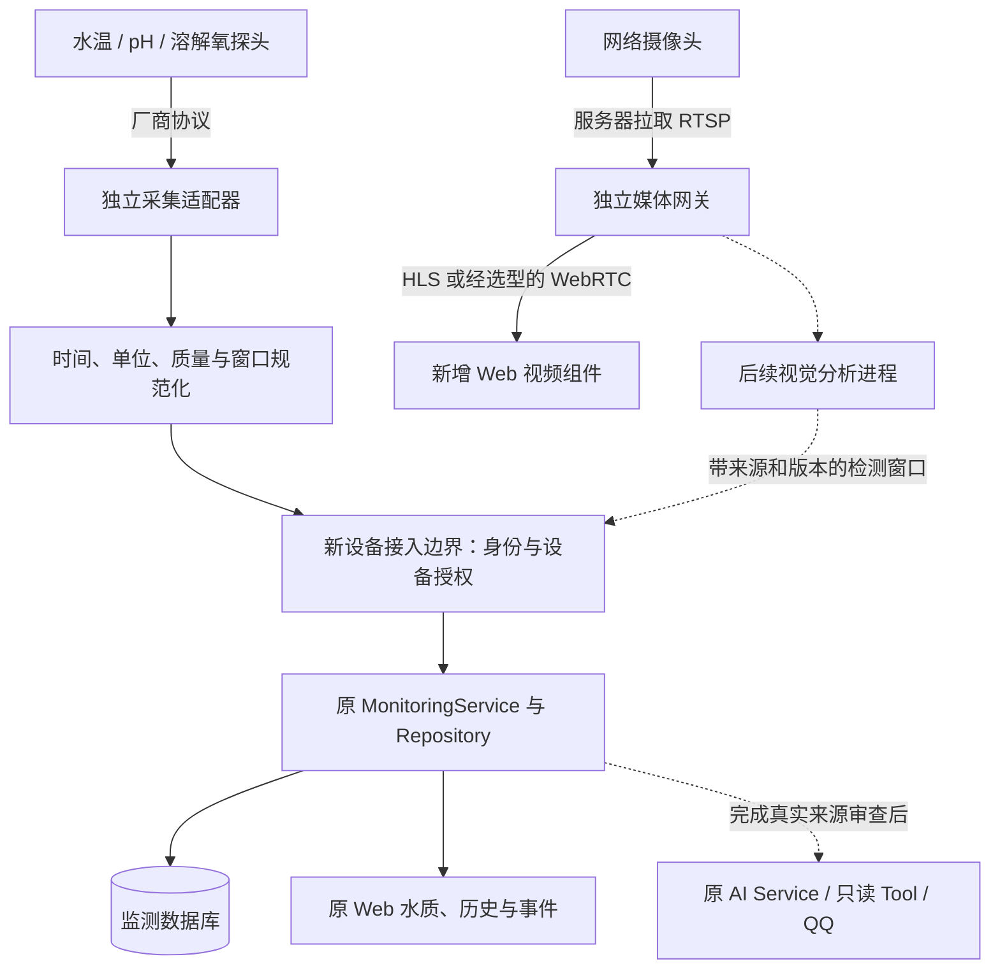

# 真实设备接入方案与接口格式要求

版本：设计初稿 v0.1，2026-10-29。对象：Fishery Management，源码核查基线 `87f52a7`。面向项目组、设备提供方与后续开发人员。

**本文是调查与待实现方案，不是已经开放的硬件接入手册。** 本次仅核查源码、标准资料并编写文档，没有接设备、拉视频、打开业务数据库、修改接口或调用模型。

## 1. 先说结论：数据和视频走两条链路

推荐路线：

> 水质传感器 → 独立采集适配器 → 规范化观测窗口 → 受控设备接口 → Monitoring。
>
> 网络摄像头 → 独立媒体网关拉流 → 浏览器可播放的媒体协议 → Web 视频组件。
>
> 如需视觉识别：从媒体网关另接分析进程，将真实检测统计作为第三类业务输入上报，而不是把视频文件放入监测 JSON。

真实接入需要分别完成“设备能读到”“应用能正确理解来源和时间”“视频能播放”“检测结果有效”四个验收项。只有前两项完成后，才适合讨论将真实事实开放给 AI/QQ。

### 当前能力与缺口

| 项目 | 当前已具备 | 真实接入仍需开发 / 验证 |
|---|---|---|
| 水质数据 | 本机模拟器 HTTP 上报、窗口校验、SQLite 存储、历史与规则 | 传感器驱动、真实身份、标定与真实来源合同 |
| 设备身份 | 预配置模拟设备白名单 | 采集器与物理探头注册、凭据、养殖池映射及撤权 |
| 视频 | 视觉统计与占位页面；`stream_url=null` | RTSP 等媒体接入、网关、播放器、播放鉴权与重连 |
| 视觉分析 | 模拟统计字段、规则与事件处理 | 实际分析进程、模型版本、有效帧和真实标定证据 |
| AI/QQ | SIMULATOR 来源的当前水质只读问答 | 真实来源、Prompt/Scope/授权与规则适用范围的独立审查 |
| 外部访问 | Web 默认仅绑定 `127.0.0.1`，上报只认回环地址 | 如需跨机器接入，另建受控 HTTPS 接入边界，不能直接公开现有开发服务 |

因此，不能仅把 `sim-pond-1` 改成真实设备名称、把 `source_kind` 改为真实，或填入 RTSP URL 就宣称接入完成。

## 2. 推荐的整体架构（未来方案）



实线和虚线都描述待开发接入路线；实线为首批接入建议，虚线为后续独立阶段。原 Monitoring、历史、事件和 Agent 应尽量复用，不把串口、解码、推理或摄像头重连放进 Web 请求或监测事务。

**默认采用采集器向应用上报、媒体网关从摄像头拉流。** 某些设备只支持主动推流时，再按其实际协议适配；RTSP 地址不是 HTTP 业务上报地址，也不是默认的推流地址。

## 3. 开发前必须向设备提供方确认的信息

| 水质设备资料 | 摄像头资料 |
|---|---|
| 厂家、型号、固件、探头量程与精度 | 厂家、型号、固件、路数及所需并发观看人数 |
| RS-485 / USB 串口 / 以太网及实际协议 | 是否支持 RTSP、ONVIF，或仅有厂商 SDK |
| Modbus 地址、功能码、寄存器表，或完整私有报文说明 | 流地址获取方法、主/子码流、只读账号的权限 |
| 波特率、校验位、停止位，或 IP/端口 | 视频编码、分辨率、帧率、码率、关键帧间隔、音频格式 |
| 数值类型、字节/字顺序、倍率、无效哨兵值及错误码 | 网络拓扑、跨网需求、可接受延迟、是否需要录像 |
| 采样/刷新周期、缓存机制、时钟来源 | 摄像头时间、NTP、流时间戳与实际采集时间的关系 |
| 标定方法、标定日期、温度补偿、DO 单位 | 是否需要检测/测长，是否有有效的水下标定条件 |
| 每个探头的物理编号、对应鱼塘和安装位置 | 摄像头编号、鱼塘绑定、视角、隐私及保存期限 |

当前没有给出具体设备型号，因此不能确定某寄存器地址、串口配置、RTSP 路径、检测模型或硬件性能。不要把示例地址和参数当作设备默认值。

RS-485 是电气接口，不能单凭“有 RS-485”就认定支持 Modbus。若设备是 Modbus，应依厂商寄存器文档与 [Modbus 官方规范](https://www.modbus.org/modbus-specifications) 实现；若已有 MQTT 上报，可增加受控订阅适配器，不能假设 Management 已有 Broker。MQTT 的传输确认也不能替代业务批次去重与落库确认，协议依据见 [OASIS MQTT 5.0](https://docs.oasis-open.org/mqtt/mqtt/v5.0/os/mqtt-v5.0-os.html)。

## 4. 当前已有的窗口接口：准确格式

本节描述**现有模拟接口**，用于理解可复用的统计与校验合同。它不是跨机器真实设备接口。

### 4.1 HTTP 请求与访问限制

```http
POST http://127.0.0.1:8766/api/ingestion/batches
Content-Type: application/json
X-Simulator-Token: <本次启动产生的令牌，不在文档中填写>
```

- 必须显式启用 ingestion；默认不能上报。
- Web 只绑定回环地址；处理器还检查请求来源为回环地址、Host 白名单和 Token。
- Token 为32～128个 ASCII 字母或数字，使用私有启动流程提供；不是设备证书。
- 拒绝带 `Origin` 的上报和非 JSON 媒体类型；不靠打开 CORS 接入硬件。
- 报文上限 **8 KiB**；JSON 禁止重复字段和非有限数值，字段集合按合同严格校验。
- 对象中不能擅自增加 `source`、`camera_url` 或原始视频。监测报文 `schema_version=1` 与 SQLite 当前 v2 是两种独立版本，不能混用。

依据：[Web 上报处理](../../../management_web/app.py)、[模拟上报器](../../../simulator/transport.py)、[合同校验](../../../monitoring/contracts.py)。

### 4.2 完整水质示例（虚构，仅用于格式说明）

下面是合法的窗口结构，`visual=null` 表示这个报文不提供视觉窗口。文档中的时间是固定样例，**不得把它直接发送后冒充新鲜观测**；真实运行必须使用实际采集时间。

```json
{
  "schema_version": 1,
  "batch_id": "example-batch-0001",
  "session_id": "example-session-0001",
  "sequence": 0,
  "device_id": "sim-pond-1",
  "timestamp": "2026-10-29T08:00:10Z",
  "window": {
    "start": "2026-10-29T08:00:00Z",
    "end": "2026-10-29T08:00:10Z",
    "duration_s": 10
  },
  "water": {
    "aggregation": "window_mean",
    "sample_count": 10,
    "metrics": {
      "temperature_c": {
        "unit": "°C", "mean": 26.5, "min": 26.5,
        "max": 26.5, "latest": 26.5,
        "valid_samples": 10, "invalid_samples": 0
      },
      "ph": {
        "unit": "", "mean": 7.4, "min": 7.4,
        "max": 7.4, "latest": 7.4,
        "valid_samples": 10, "invalid_samples": 0
      },
      "dissolved_oxygen_mg_l": {
        "unit": "mg/L", "mean": 6.2, "min": 6.2,
        "max": 6.2, "latest": 6.2,
        "valid_samples": 10, "invalid_samples": 0
      }
    }
  },
  "visual": null
}
```

### 4.3 字段约束

| 字段 | 当前要求 |
|---|---|
| `batch_id` | 批次标识；重传同一批应保持 ID、内容不变 |
| `session_id` | 观测会话标识；采集进程重新开始会话时换新 ID，不因普通重传而换 ID |
| `sequence` | 同会话递增整数，范围0～2³¹−1；不要因一次 HTTP 超时重新编号同一批 |
| `device_id` | 服务端已注册设备；不是任意填写的显示名称 |
| 三种 ID | 首字符为 ASCII 字母/数字，其后可用字母、数字、`_`、`-`，总长1～64 |
| `timestamp` | 必须等于 `window.end`；带时区，服务归一化为 UTC |
| `window` | 窗口时长1～60秒；起止差值与 `duration_s` 一致，容差0.001秒 |
| 时间准入 | 窗口末端不得晚于服务时钟，且距接收时刻不得超过300秒 |
| `water` / `visual` | 可以有一项为 null，不能同时为 null；null 不代表“正常” |
| `sample_count` | 尝试采样次数，整数1～600；不是传感器额定采样率 |
| `metrics` | 三个指标字段必须都存在；单位固定为 `°C`、空字符串、`mg/L` |
| 统计值 | 有效点存在时，mean/latest 都在 min～max 内；数值必须有限且在技术校验范围内 |
| 无有效点 | mean/min/max/latest 全为 null，`valid_samples=0`；缺测不补0 |
| 点数关系 | valid/invalid 均为非负整数，和不大于 sample_count；差额可表示未取得读数 |

技术范围为水温−50～100°C、pH 0～14、DO 0～100mg/L，仅用于数值合同校验，**不是健康阈值、硬件精度或养殖适宜范围**。DO 百分比饱和度不能直接当作 mg/L；需要设备补偿信息时，先按厂商方法转换并记录条件，不能随便换单位。

只有一个实际采样点时可以形成真实的单点统计，但必须如实计为1；不能把设备缓存的同一读数重复计成10次新采样。多探头刷新周期不同，需要在适配层统一明确时间网格，或另行扩展每指标采样合同，不能伪造共同采样次数。

### 4.4 当前应答与错误语义

| HTTP / 内容 | 含义 |
|---|---|
| 200：`{"status":"accepted","updated_channels":["water"]}` | 新窗口更新对应当前通道；实际列表可包含 visual |
| 200：`{"status":"duplicate","updated_channels":[]}` | 留存去重范围内同批次/会话序号、同内容，无重复业务写入 |
| 200：`{"status":"out_of_order","updated_channels":[]}` | 较早窗口可能保留在历史，但没有更新当前值；不等于新鲜当前状态 |
| 400 + `error_code` | JSON/字段/单位/时间等合同错误，例如 `INVALID_WINDOW`、`OBSERVATION_TIME_REJECTED` |
| 403 + `error_code` | 未开启、来源/令牌拒绝、传输拒绝或设备不在白名单 |
| 409 + `error_code` | `BATCH_ID_CONFLICT` 或 `OBSERVATION_CONFLICT`，不能改 ID 掩盖冲突继续上传 |
| 413：`REQUEST_TOO_LARGE` | 超过大小限制 |
| 500：`SERVICE_UNAVAILABLE` | 服务内部失败，不能假定已成功写入 |

去重只覆盖当前有限留存范围，不是永久 exactly-once 承诺。当前模拟上报器超时3秒、禁止重定向和自动重试；未来真实采集器若做断网重传，必须另外规定有界队列、相同批次重传及结果未知处理，不能照搬 QQ 的单次回复规则，也不能无限重试。

### 4.5 当前视觉统计格式（不是视频流）

用以下对象替换前面报文的 `visual`，可描述一个有20帧有效分析结果、尚未标定长度的窗口。它仍是**虚构模拟统计样例**：

```json
{
  "aggregation": "window_summary",
  "frames_processed": 20,
  "valid_frames": 20,
  "anomaly_counts": {
    "suspected_lesion": 0,
    "surface_anomaly": 0,
    "suspected_dead": 0
  },
  "behavior_ratios": {
    "normal_activity": 1.0,
    "reduced_activity": 0.0,
    "feeding": 0.0,
    "feeding_anomaly": 0.0,
    "unknown": 0.0
  },
  "length": {
    "average_length_cm": null,
    "length_sample_count": 0,
    "valid_frame_count": 0,
    "calibration": "uncalibrated",
    "calibration_id": null
  },
  "visible_fish_count": 3.5,
  "model_version": "sim-example-v1"
}
```

`frames_processed` 为1～6000，`valid_frames` 为0～处理帧数；每种异常计数不得超过有效帧数。计数表示**有效帧中检出该信号的次数**，不是确诊鱼数或去重后的个体数。行为比例有效帧存在时合计为1；无有效帧时为0。`visible_fish_count` 是窗口统计，可为小数，不是已经跟踪去重的鱼总数。

现有长度字段只接受 `uncalibrated` / `simulated`；不能将真实标定谎称 `simulated`。无有效视频帧时不能报“20帧全正常”；应按无效/缺失统计处理，不能用零异常计数触发假恢复。真实视觉来源、真实标定、算法版本和可靠性需要另行扩展合同。

## 5. 真实传感器接入：建议的新合同（尚未实现）

### 5.1 最小适配职责

独立采集器负责读取厂家协议、识别断线/错误码、转换单位、记录真实采样时间、形成窗口。Management 接收边界负责鉴权、设备绑定、来源认定和合同校验，再调用统一 Monitoring 业务服务；采集器不能直写 SQLite。

推荐第一批仍采用 HTTP 窗口 JSON，复用现有水质统计语义。设备只提供原始点时，由采集器聚合，不要求传感器本身实现全部统计。MQTT、串口、厂商 SDK 等留在采集器一侧，避免让 Web 为每个型号新增一套领域规则。

### 5.2 规划中的新端点与请求结构

以下仅为待评审设计，**Management 当前没有这个端点，也不能直接加载这个合同**：

```http
POST https://<批准的设备接入主机>/api/device-ingestion/v1/windows
Content-Type: application/json
Authorization: Bearer <设备接入专用凭据，由私有存储管理>
```

建议首版以专用 HTTPS 接入边界识别采集器，凭据映射到服务端登记的 `collector_id` 与允许设备；需要更强设备身份时评估 mTLS。它不是 QQ Token、网页维护 Token 或原 `X-Simulator-Token`。

请求字段建议如下；未冻结前不要据此实现厂家固件：

| 字段 | 建议要求 |
|---|---|
| `contract` | 固定候选值 `fishery-device-window@draft1`，与模拟报文 v1 分开 |
| `collector_id` | 已认证采集器声明，必须与凭据身份一致，不能自报即信 |
| `batch_id/session_id/sequence` | 保持批次、会话、顺序与重传语义 |
| `device_id` | 绑定到批准的养殖池/监测设备；物理探头与指标映射另存受控注册表 |
| `timestamp/window` | 实际 UTC 观测时间和窗口，不以发送或重传时间替代 |
| `water` | 优先沿用第4节的统计字段与单位，严格处理缺测、无效和采样覆盖 |
| `visual` | 首批水质接入固定为 null；后续分析工作进程另行授权 |

不接受请求正文决定 `source_kind`、阈值、事件状态或任意文件路径。服务端从认证注册信息产生真实来源、探头身份、标定版本与接收时间，并保留原始声明用于必要审计；字段叫什么、怎样存储仍需正式设计审查。

新接口应延续清晰的 accepted/duplicate/out_of_order/拒绝语义，只有业务持久化完成后才声明成功；需要写前队列时必须明确“入队”与“落库”的不同状态。批次冲突、Schema 不支持和权限不足不能自动改包绕过。

### 5.3 不能省略的来源与业务改动

- 当前 `ObservationRef`、服务投影及 AI 来源合同均存在 simulator 限制，需要显式支持真实身份，不能只改网页标签。
- 设备注册需区分鱼塘、业务 device、物理探头、摄像头与采集器；一个鱼塘可以有多路设备，不强行把摄像头 ID 当作探头 ID。
- 定义时钟偏差检测、同步状态和断网补传。现接口拒绝未来时间和超过300秒的窗口；长期离线回补必须另行设计，不改时间戳骗过校验。
- 真实采样周期会影响30秒 stale、90秒 offline 等当前默认评估参数。阈值应按批准合同适配，不能靠定时重复旧值维持在线。
- 历史留存目前有记录上限；10秒窗口不意味着永久保存原始传感器数据。真实监测须先明确保存期、容量、备份和追溯需求。
- 校验范围、实验水质规则与专业养殖标准不是同一层。接入真实水之前，要确认物种、环境、标定和规则适用性。

尚不能断言“无需数据库迁移”。新增可信来源、标定引用、设备映射和长期追溯可能需要扩展持久化；应先做新建隔离库验证、备份与兼容方案，再申请旧库变更。本报告不操作任何数据库。

## 6. 视频接入：协议、格式与播放接口

### 6.1 摄像头到媒体网关

建议优先核验摄像头提供的 RTSP 流，由服务器侧媒体进程读取；RTSP 用于控制媒体会话，实际传输与设备协商。设备所用版本必须查手册；[RTSP 1.0 RFC 2326](https://www.rfc-editor.org/rfc/rfc2326) 已被 [RTSP 2.0 RFC 7826](https://www.rfc-editor.org/rfc/rfc7826) 替代，不能因为有新规范就假定已有摄像头支持2.0。

示意地址：`rtsp://<摄像头私有地址>:<端口>/<厂家提供的流路径>`。用户名和密码通过服务端私有配置引用，不把含凭据的 URL 发到浏览器、日志或 PPT。

如厂家提供 ONVIF，可用于能力确认与媒体配置；支持某 Profile 不等于项目已经接入所有发现、PTZ 或事件能力。可参考 [ONVIF Profile T](https://www.onvif.org/profiles/profile-t/)，实际以设备合规能力和接口实测为准。

若来源为 USB 摄像头或仅有厂家 SDK，应由现场采集进程采帧/编码后接媒体网关；不能凭网络摄像头的方案假定其原生支持 RTSP。

### 6.2 媒体网关到浏览器

不要将 `rtsp://...` 直接塞进现有网页播放器。现有页面连播放器都尚未装配；需要选择浏览器媒体路径并验证目标浏览器、编码和鉴权。

| 候选 | 对接形式 | 适合何种首版 | 必须补齐 |
|---|---|---|---|
| HLS | HTTPS 播放列表 `.m3u8` 与媒体分片 | 先验证稳定预览，不要求极低延迟 | 按浏览器能力选原生播放或播放器库；直播窗口、分片授权与缓存策略 |
| WebRTC | 经过信令协商取得媒体轨道，不是一个普通视频文件 URL | 明确需要低延迟交互预览时再选择 | 信令、SDP、ICE、必要的 STUN/TURN、网络与浏览器验证 |
| MJPEG | HTTP 持续传输 JPEG 帧 | 少路、低帧率的调试预览候选 | 带宽限制、连接管理；不默认作为长期多路方案 |

首批建议**先打通摄像头拉流，再选一种浏览器出口**。没有明确低延迟要求时先评估 HLS；如需求明确为低延迟，则在媒体网关确定后直接评估 WebRTC。不要求首批同时实现两套。

协议依据为 [HLS RFC 8216](https://www.rfc-editor.org/rfc/rfc8216) 与 [W3C WebRTC](https://www.w3.org/TR/webrtc/)。实际延迟取决于摄像头编码、关键帧、分片/缓冲、网络和解码，不能预先承诺某个秒数。

编码首轮可申请 H.264 测试流，确认 profile/level、像素格式、分辨率、帧率和关键帧间隔与所选媒体出口及浏览器匹配；H.265 不应未经验证就视为通用播放格式。兼容时优先转封装，不兼容才评估转码及其 CPU/GPU 开销。默认不需要音频时关闭音轨，减少额外兼容和隐私问题。

### 6.3 未来摄像头元数据接口示例

以下 **候选接口尚未实现**。建议 `GET /api/cameras` 返回已批准摄像头的非敏感元数据，采用逻辑 `stream_id`，不泄露 RTSP 地址和凭据：

```json
{
  "contract": "fishery-camera-view@draft1",
  "cameras": [
    {
      "camera_id": "camera-01",
      "device_id": "pond-01",
      "source_kind": "camera",
      "stream_id": "pond-01-main",
      "stream_state": "online",
      "last_frame_at": "2026-10-29T08:00:10Z",
      "playback": {
        "protocol": "hls",
        "url": "/media/pond-01-main/index.m3u8",
        "authorization": "same-origin-session"
      },
      "analysis_state": "not_enabled",
      "detections": []
    }
  ]
}
```

`online` 必须来自实际媒体健康检查与帧进展，不能因为配置里有 URL 就认为在线。`analysis_state=not_enabled` 明确表示能播放不代表已识别；空 detections 在未分析时不能解释为“没有异常”。示例 URL 是候选同源代理路由，不是现有 Management 可访问地址。

若最终选择 WebRTC，须用其信令会话合同替换上述 HLS 描述，不能只把 `protocol` 字段改名就复用播放逻辑。

### 6.4 播放安全与故障边界

- Management 只暴露登记后的 `stream_id`，管理员配置媒体上游；不接收聊天或任意网页用户提供的 URL，避免任意网络访问。
- 摄像头账号使用只读权限；媒体查看权限与设备数据/AI 权限分开，水质授权不自动等于视频查看授权。
- 当前 CSP 为同源限制；真实播放器可能涉及媒体、信令、Worker 或 blob。按选定实现逐项增加必要来源，不能全局改成 `*`。
- 保持 HTTPS 页面、播放和信令的方案一致，处理会话、过期、跨域与无缓存凭据；ONVIF/RTSP 原始账号不传前端。
- 网络拉流、解码和录像使用有界独立进程；限制路数、连接、内存与重连次数，失败不拖住 Web/Monitoring。
- 页面离开应释放自己的播放资源；服务停机应回收本次媒体工作进程，不终止其他用户的媒体服务。
- 录像首版可不做。若做，需独立容量、分片、磁盘满和保存期策略，不把大视频写入 Monitoring SQLite。

## 7. 视频、视觉分析与水质怎样关联

三者通过**养殖池/设备映射和观测时间**关联，而不是仅看“它们刚好同时上报”。

1. 水质记录真实采样与窗口时间；视频保留流会话和时间戳到实际时间的映射。接收时间不能冒充采集时间。
2. 视觉分析统计必须记录摄像头、流会话、分析版本、处理/有效帧和窗口；实际丢帧、解码失败不能补成正常帧。
3. 测长需要真实标定、视角、尺度及适用条件；像素长度不能直接变成厘米。没有标定时不输出“真实平均体长”。
4. 未来框坐标需要约定图像宽高、坐标系、置信度和帧时间，页面叠加应与对应帧对齐。现有 `detections=[]` 不是已经支持叠框的证明。
5. 设置允许的跨通道时间差；无法对齐时分别展示，不能让旧视频或旧 DO 读数形成当前联合诊断。

当前视觉统计接口不包含原始图像，业务接收接口也不应混入 Base64 图片或视频大包。需要截图/片段时另设计受控媒体存储引用。

## 8. 建议实施顺序与文件范围

| 阶段 | 可独立验收的目标 | 预计涉及范围（不是已修改清单） |
|---|---|---|
| D0 设备确认 | 一份传感器寄存器/报文表、一份摄像头媒体能力表 | 厂家资料、字段映射与测试计划 |
| D1 只读采集 | 单探头可解码、单位和时间正确，断线如实呈现；不写业务库 | 新采集适配模块，先用串口/网络 Fake 与离线报文 |
| D2 真实水质接入 | 新鉴权、真实来源、窗口与 Monitoring 复用，隔离库验证 | contracts、接收边界、service/current/analysis 投影、设备注册；必要时显式迁移设计 |
| V1 视频预览 | 一路摄像头经独立媒体进程在浏览器播放并可安全停止 | 新媒体装配、`VideoDetection` 扩展、前端 video 组件、必要 CSP |
| V2 视觉分析 | 有效帧、真实模型/标定证据与窗口关联 | 独立分析进程、视觉合同、来源和规则适用审查 |
| A1 AI/QQ 真实事实 | 本轮只读事实正确标识为真实来源，Scope 重新审阅与批准 | SourceSummary、Prompt/输出合同、Tool 来源投影和独立运行授权 |

优先验证 D1/D2 与 V1，可以并行推进，但不要以“视频能播放”作为 V2 通过。现有 QQ 水质解释限定 SIMULATOR，未经 A1 不应把真实数据伪装成模拟信号送给模型。

本阶段只写方案，不实施上述代码或数据库变更；不修改 `D:\Fishery_Project`、Prototype 或其他项目。

## 9. 验收清单

| 类别 | 至少覆盖 |
|---|---|
| 设备与单位 | 寄存器/类型/倍率/字序；pH、DO 单位；标定、无效哨兵和越界 |
| 时间 | UTC、时钟偏差、重启新 Session、缺口、不同采样频率、断网补传不伪造新鲜度 |
| 上报 | 合法窗口、重复、冲突、乱序、超限、坏 JSON、未知设备、失效凭据、服务重启 |
| 业务 | 当前/历史一致；缺测/离线不假恢复；来源正确；不同设备与周期独立 |
| 视频 | 正确账号、无权限、错误编码、断线、卡住不出帧、多路/多观众、切页与进程退出 |
| 资源 | 带宽、CPU/GPU、内存、磁盘满、录像保存期；仅回收自己的进程 |
| 视觉 | 有/无有效帧、丢帧、标定缺失、模型版本、时间对齐；不把未知当零异常 |
| AI 与兼容 | 未批准时不开放真实数据给模型；Web、模拟器、原事件和 QQ SIMULATOR 模式继续工作 |

先使用新建合成库、Fake 采集器和本地测试视频进行自动化验证；接触真实设备、真实凭据、真实业务库或外部模型前，分别确认授权与停写/备份需求。实测报告应分别记录数据可达、数据可信、视频可播放、视觉可评估与 AI 可使用，不能合成一个模糊的“已接入”。

## 10. 用于汇报的准确表述

可描述为：

> 当前已完成模拟数据下的监测管理与 QQ Agent 原型；真实设备接入拟采用“采集适配器 + 统一监测合同”处理水质，采用“独立媒体网关 + 浏览器播放协议”处理视频，后续逐项验证真实身份、时间、标定和资源边界。

不能描述为“真实传感器、摄像头/NPU、实时视觉分析和自动设备控制已经全部接入”。本报告中的新端点和 JSON 草案只表示待评审设计。

## 11. 核查资料与源码入口

标准资料核验日期：2026-10-29。未连接 QQ、Qwen 或任何真实设备。

| 资料 | 版本 / 日期 | 本报告用途 |
|---|---|---|
| [RTSP 1.0](https://www.rfc-editor.org/rfc/rfc2326)、[RTSP 2.0](https://www.rfc-editor.org/rfc/rfc7826) | RFC 2326，1998-04；RFC 7826，2016-12，替代前者 | 区分媒体会话控制、设备版本和实际流传输 |
| [HLS](https://www.rfc-editor.org/rfc/rfc8216) | RFC 8216，2017-08，Informational | 浏览器出口候选；不作为所有浏览器兼容或延迟保证 |
| [WebRTC](https://www.w3.org/TR/webrtc/) | 页面标注 W3C Recommendation，2025-03-13 | 浏览器实时通信 API 与协商路径 |
| [ONVIF Profile T](https://www.onvif.org/profiles/profile-t/) | 页面未列统一发布日期 | 摄像头能力核查，不代表应用已实现 ONVIF |
| [Modbus 规范入口](https://www.modbus.org/modbus-specifications) | Application Protocol V1.1b3 / Serial Line V1.02 等；页面未列统一日期 | 驱动依厂商寄存器表实现，不能猜测设备字段 |
| [MQTT 5.0](https://docs.oasis-open.org/mqtt/mqtt/v5.0/os/mqtt-v5.0-os.html) | OASIS Standard，2019-03-07 | 已有 MQTT 设备的可选适配参考，不新增 Broker 承诺 |

本项目源码依据：

- [monitoring/contracts.py](../../../monitoring/contracts.py)：窗口 v1、单位、时间、点数、视觉统计与来源限制。
- [management_web/app.py](../../../management_web/app.py)：上报门禁、8 KiB 限制、错误返回、CSP。
- [management_web/__main__.py](../../../management_web/__main__.py)：回环绑定与显式 ingestion 开关。
- [monitoring/repository.py](../../../monitoring/repository.py)：事务、去重、冲突、乱序与留存范围。
- [monitoring/service.py](../../../monitoring/service.py)：数据投影、默认时效和 `stream_url=null`。
- [management_web/static/app.js](../../../management_web/static/app.js)：当前视频占位与模拟统计页面。
- [ai_service/channel.py](../../../ai_service/channel.py)：SourceSummary 的 simulator 限制。
- [组员技术路线](../../TECHNICAL_ROUTE_TEAM.md)、[启动指南](../../BUILD_RUN.md)：当前项目能力和使用边界。
